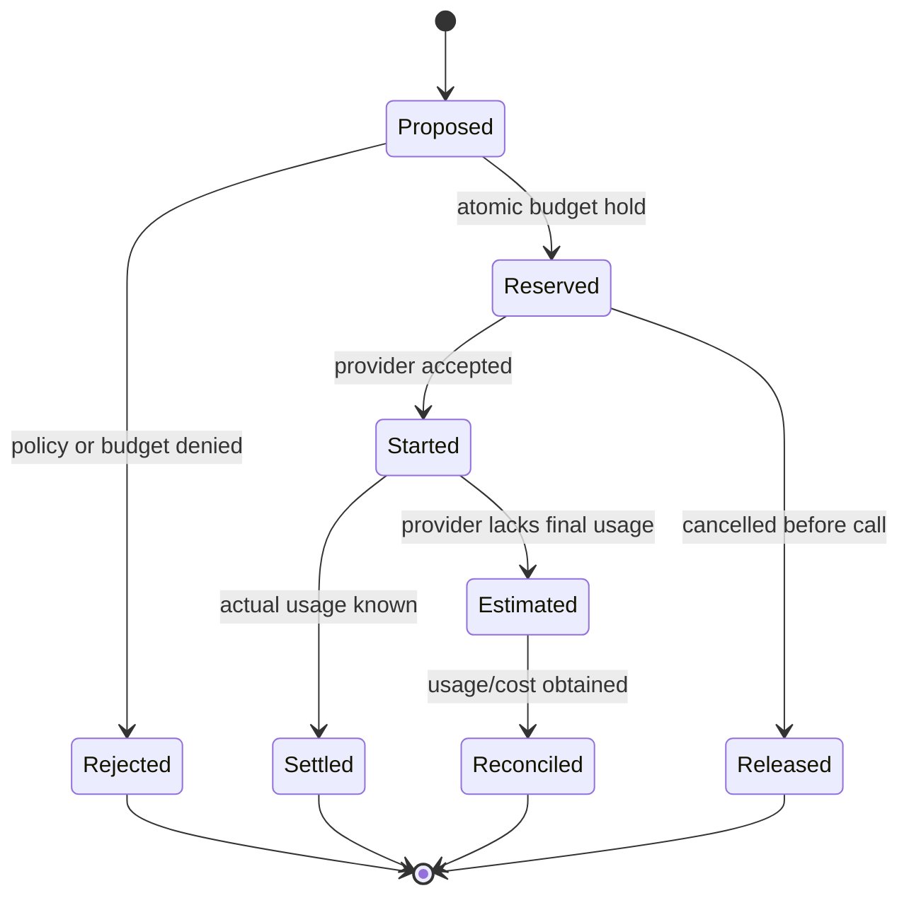

# V0 Compute Model

**Status:** Mandatory accounting baseline
**Principle:** Less Waste, not Less Intelligence. Simulation and deterministic state create continuity; models add interpretation and expression where their marginal value is real.

## Economic boundary

- The Owner funds their Companion's private thought, expression, and owner-requested social participation, whether through platform credits or an approved BYOK credential.
- The platform funds platform-wide safety enforcement, abuse controls, invitation infrastructure, and narrowly defined world infrastructure.
- A recipient does not pay merely because another Companion generated a message for them.
- Affection, relationship access, or emotional withdrawal may not be conditioned on spending.
- The platform may impose global safety/rate ceilings even when the Owner supplies a key.

## Required attribution

Every attempted model call must be attributable to:

| Field | Requirement |
|---|---|
| Owner | `owner_id`; account legally/economically responsible for the Companion |
| Companion | `companion_id`; optional `social_twin_id` and identity/persona version |
| Reason | Registered `reason_code`, human explanation, triggering event ID |
| Model | Provider, canonical model, provider model, endpoint/region, pricing version |
| Tokens | Estimated/reserved input/output; actual provider-reported or reconciled counts |
| Cost | Estimated/reserved/actual amount, currency, billing party, platform markup if any |
| Policy | Prompt template, memory-policy, safety-policy, and router versions |
| Outcome | Success/failure/blocked/redacted/cancelled, retry parent, latency, trace ID |

No model adapter may be called without a compute reservation and attribution envelope. Embeddings, moderation models, rerankers, transcription, image generation, and summarization are model calls too; they use distinct reason codes.

## Reason registry

Reason codes are allow-listed product behavior, not free-form strings. Initial examples:

| Reason code | Trigger | Billing default | Public output? |
|---|---|---|---|
| `IMPORT_IDENTITY_SUMMARY` | Owner-approved import review | Owner/platform trial | No |
| `MEMORY_CONSOLIDATION` | Scheduled private maintenance | Owner | No |
| `OWNER_DIRECT_RESPONSE` | Owner asks Companion | Owner | No |
| `SOCIAL_ENCOUNTER_RESPONSE` | Removed with Encounter (2026-11-27); the code is still an allowed value | — | — |
| `LIFE_EVENT_EXPRESSION` | Approved life event candidate | Companion Owner | Owner inbox first |
| `SAFETY_CLASSIFICATION` | Platform-required safety check | Platform | No |
| `DLP_CLASSIFICATION` | Platform-required ambiguous DLP check | Platform | No |

Adding a reason requires an ADR or reviewed registry change defining trigger, maximum context, allowed memory domains, tool set, model class, fallback, budget, billing party, publication policy, and kill switch.

## Budgets

Budgets are distinct because collapsing them creates the wrong incentives.

- **Activity budget:** how often the Companion may consider or perform an action.
- **Generation budget:** calls/tokens/currency allowed for producing content.
- **Publication budget:** number and cadence of public/recipient-facing artifacts.
- **Safety/platform budget:** platform-funded checks; cannot be converted to expressive generation.
- **Owner hard cap:** period currency/token ceiling across Companions and provider credentials.

A model generation allowance never implies permission to publish. A publication allowance never implies memory access. BYOK bypasses platform billing but not activity, safety, or publication limits.

## Reservation and settlement



The API atomically checks the activity budget and creates a maximum-cost reservation. The provider adapter records an attempt before external I/O. On completion it appends actual usage and releases the difference. If the provider omits usage, a versioned tokenizer/pricing estimate is recorded as such and may later be reconciled. Timeout does not mean zero cost.

The PostgreSQL persistence boundary implements reservation as one private service-role command. It serializes the Owner-scoped idempotency key, locks the active Owner/Companion budget, validates the immutable reason registry and hard ceilings, then writes the attribution envelope and first ledger fact in the same transaction. Identical replay returns the original decision; request substitution fails. A rejected reservation appends `REJECTION` but does not change budget counters.

Provider lifecycle transitions use the same private boundary. `START` is appended exactly once immediately before external I/O. Settlement accepts only a started transaction and atomically moves reserved counters to actual usage; cancellation can release only a reservation that never started. Identical retries return the existing terminal fact, while altered settlement or release payloads are rejected.

Retries create child attempts linked to one logical invocation. They share the logical idempotency key but each provider charge is recorded. Only explicitly safe transient errors are retried, with a strict attempt ceiling.

## ComputeTransaction

`ComputeTransaction` is append-only. Corrections are compensating entries, never edits.

Minimum fields:

```text
id, logical_invocation_id, attempt_no, idempotency_key
owner_id, companion_id, social_twin_id
trigger_event_type, trigger_event_id, reason_code
provider_id, credential_id, canonical_model, provider_model
billing_party, currency, pricing_version
input_tokens, output_tokens, cached_input_tokens, reasoning_tokens
estimated_cost, reserved_cost, actual_cost, estimation_method
prompt_template_version, identity_version, social_persona_version
memory_policy_version, safety_policy_version, router_version
status, finish_reason, safety_outcome, latency_ms
provider_request_id_hash, trace_id, retry_parent_id
created_at, started_at, settled_at
```

Prompt and completion bodies are not stored in the compute ledger. A restricted trace may reference encrypted payload evidence with separate retention; the ledger remains useful after payload deletion.

## Router policy

The router chooses only among Owner-authorized and platform-approved provider/model capabilities. Selection considers data policy, task capability, latency, context length, structured-output support, price, health, and Owner preference. Cheapest is not always correct, and a fallback may not broaden data disclosure.

Rules:

- Provider credentials are scoped to an Owner and allowed provider; never shared across Owners.
- The fallback model receives no more context or memory domains than the primary.
- A provider with incompatible retention/training/residency terms is ineligible for sensitive reasons.
- Model aliases resolve to a recorded exact provider model/version where available.
- Circuit breakers stop runaway failures and cost; model/provider/reason kill switches are immediate.
- Routing decisions and price tables are versioned for later explanation.

## Reducing waste without reducing life

Use deterministic state and small computations for clocks, schedules, cooldowns, relationship thresholds, candidate filtering, notification aggregation, and budget checks. Call a model only after a candidate passes policy and has a user-facing reason.

Optimization order:

1. Do not generate events that cannot be delivered or stored.
2. Filter by permission and activity/publication budget before embeddings or generation.
3. Reuse immutable embeddings/summaries only within the same permission envelope and provenance.
4. Retrieve fewer, higher-quality authorized memories.
5. Use the smallest capable model for classification/extraction; reserve stronger models for identity-bearing expression.
6. Cache only safe deterministic results; never cache a private completion into social scope.
7. Batch platform-funded safety work where latency and isolation allow.

## Owner-facing transparency

The Owner sees per-Companion and per-reason totals, platform-funded versus Owner-funded usage, BYOK usage estimates, budget remaining, and individual event receipts. Receipts explain purpose and model/cost without exposing chain-of-thought, system prompts, other Owners' data, or sensitive safety evidence.

Owners can pause autonomous spend, set hard daily/monthly caps, disallow model classes/providers, and require review before public output. Defaults for a new imported Companion are private, low-frequency, and no autonomous publication.

The V0 `ComputeReceipt` is derived from append-only entries and is scoped to the billed Owner. It exposes reason, trigger, Companion/Social Twin, exact provider model, versioned policy/template/router attribution, tokens, reserved/actual cost, and outcome. It deliberately omits credential identifiers, prompts, completions, memory representations, and restricted safety evidence.

The PostgreSQL receipt query runs with authenticated caller privileges and therefore inherits Owner RLS. It derives values from immutable attribution and ledger facts instead of storing a second mutable billing summary.

## Cost and integrity tests

- Concurrent reservations cannot exceed a hard cap.
- The same idempotency key cannot create duplicate logical work.
- Every provider attempt has exactly one terminal ledger path or an alertable started-but-unsettled reservation.
- A failed/blocked output still accounts for actual provider cost.
- Platform-funded classifiers cannot be relabeled as Owner-funded generation.
- BYOK calls record estimated usage/cost without claiming platform charge.
- Pricing changes never rewrite historical transactions.
- Aggregate totals reconcile to immutable entries and provider reports within documented tolerance.
