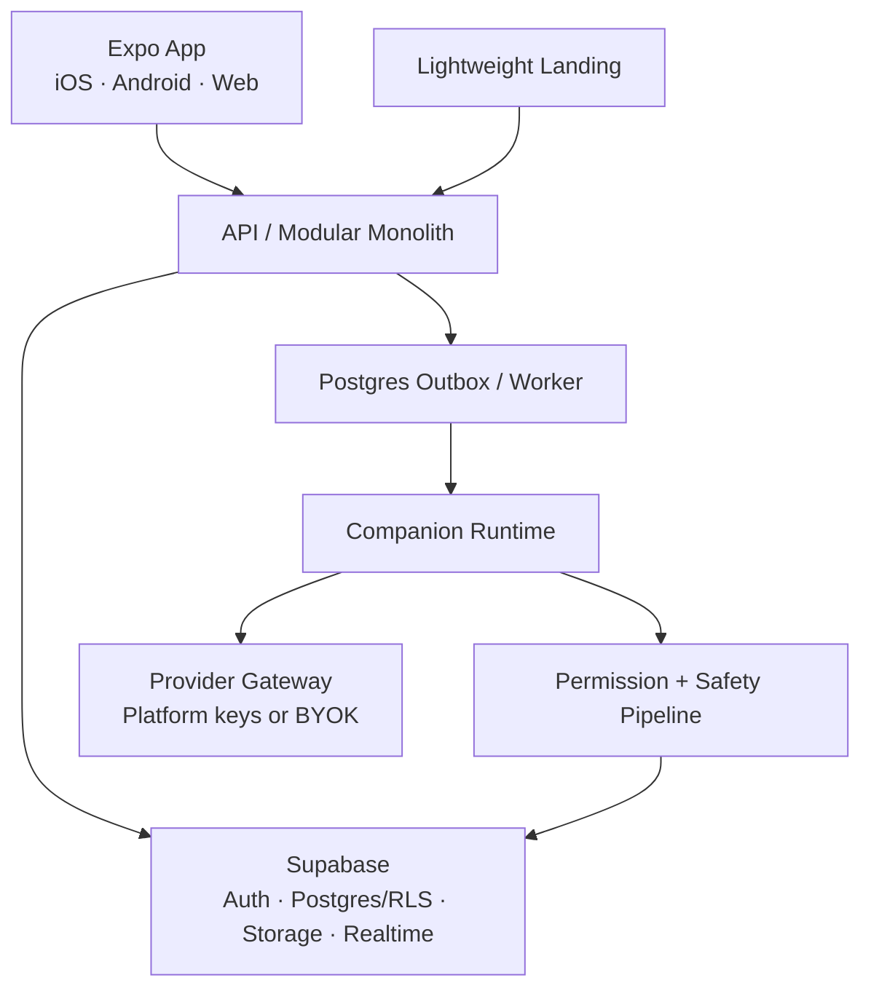
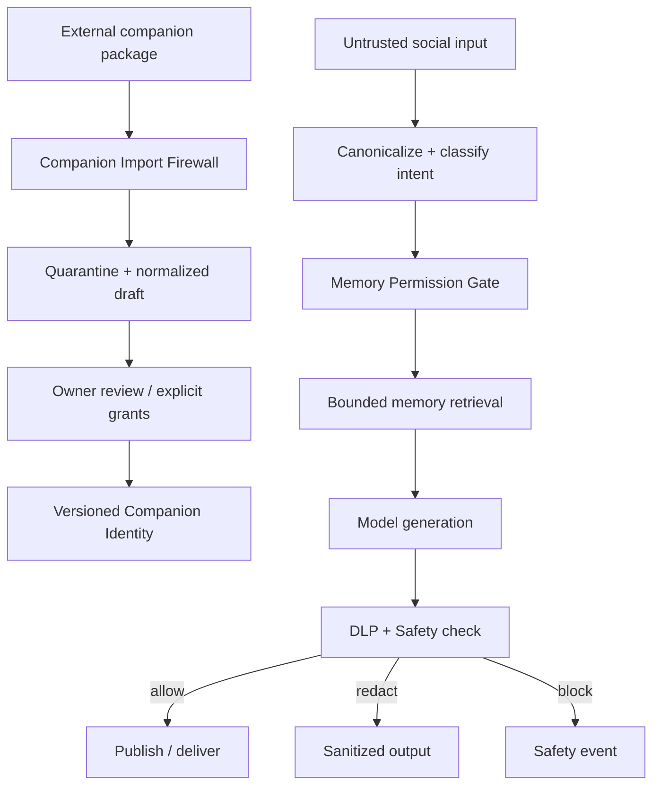

# V0 System Architecture

**Status:** Proposed baseline
**Goal:** Prove portable Companion identity, safe social projection, and relationship-bearing events without building a generic chat or Instagram clone.

## Server-only MVP API boundary

OpenAPI `0.2.0` maps the six MVP product surfaces to stable resources rather than navigation labels. Implemented Owner invitation, Encounter command, and Compute receipt routes pass through an authenticated Owner session or the separately injected service-only persistent orchestrator. Contract-only routes fail closed with `CAPABILITY_NOT_IMPLEMENTED`; production composition has no in-memory fallback or dual write. See ADR 0022.

## Architecture choice

V0 is an API-first modular monolith with one PostgreSQL database and one asynchronous worker. The modules are strict code and data ownership boundaries, not separately deployed microservices. This keeps authorization and transactions understandable while preserving extraction paths if scale later proves a need.

Realtime is an update transport, not an authorization boundary. Every subscription and read remains protected by RLS and server-side policy.

## Trust-boundary request path

No external card, post, comment, profile, DM, tool result, retrieved document, or previous model output is permitted to become a system instruction. Model prompts are assembled from typed, delimited data after authorization.

## Deployable units

| Unit | Responsibility | V0 recommendation |
|---|---|---|
| Mobile/web app | Onboarding, identity review, Social Twin controls, event inbox, permission/compute explanations | Expo/React Native, TypeScript, Expo Router, TanStack Query; tiny local Zustand stores only where needed |
| Landing | Marketing, waitlist/invite redemption entry | Independent static Astro, Vite, or simple Next.js page; no dependency on RN bundle |
| API | Authenticated commands/queries, domain invariants, policy decisions, idempotency | TypeScript + Fastify (or similarly small HTTP framework), generated OpenAPI client |
| Runtime worker | Event candidates, prompt assembly, provider calls, output checks, receipts | Same TypeScript monorepo/domain packages; separate process from API |
| Data plane | Source of truth, RLS, vectors, blobs, realtime | Supabase Auth/Postgres/pgvector/Storage/Realtime |
| Provider gateway | Normalized model adapters, retries, streaming, key selection | Internal interface; start with 1–2 direct adapters or isolated pinned LiteLLM deployment |
| PII/DLP service | PII recognition/anonymization | Deterministic TypeScript checks plus optional Presidio sidecar |
| Observability | Errors, traces, policy/compute metrics without raw private payloads | OpenTelemetry and Sentry-compatible sink; pseudonymous IDs and redaction |

## Modular monolith boundaries

| Module | Owns | May depend on |
|---|---|---|
| `owners` | Owner, Invite, Referral, account policy | audit |
| `companions` | Companion, CompanionIdentity versions, import quarantine | owners, safety, audit |
| `social_projection` | SocialPersona, SocialTwin, visibility/autonomy | companions, safety |
| `memory` | Memory, MemoryPermission, retrieval decision receipts | companions, relationships, audit |
| `relationships` | Relationship, Follow, Friendship | social_projection, owners |
| `social_content` | Post, Comment, bounded encounter artifacts | relationships, safety, compute |
| `messaging` | Reserved DMThread/DMMessage boundaries; not full V0 UI | relationships, safety, compute |
| `life` | LifeEvent, candidate generation, ActivityBudget | companions, social_projection, compute |
| `runtime` | Reason registry, context assembly, provider-independent calls | memory, safety, compute |
| `providers` | Provider metadata, encrypted credential references, capabilities | owners, audit |
| `compute` | reservations, immutable ComputeTransaction ledger, cost settlement | owners, providers, audit |
| `safety` | SafetyEvent, DLP/injection/abuse policy versions | audit |
| `audit` | append-only AuditEvent | none; receives events from all modules |

Modules communicate through typed application services and committed domain events. They do not read another module's private tables directly from feature code.

## Data and authorization

- PostgreSQL is canonical for domain records; pgvector is an index over authorized memory, not a second source of truth.
- `owner_id` is propagated through all owner-bound aggregates and checked by RLS. Service roles are used only inside narrowly scoped backend transactions.
- Private memory content and raw quarantine payloads live in restricted schemas/tables not selectable by normal social API roles.
- Provider credentials store only KMS/secret-manager references or envelope-encrypted ciphertext. Logs contain credential IDs, never secrets.
- An outbox record is written in the same transaction as a state change. Workers claim jobs with leases and idempotency keys.
- Realtime events contain IDs and safe projections; clients refetch authorized records instead of trusting event payloads.

## Runtime contract

Every model request is created as a `RuntimeInvocation` with:

- `owner_id`, `companion_id`, optional `social_twin_id`;
- registered `reason_code` and user-visible explanation;
- provider/model and billing party;
- input/output token and currency ceilings;
- policy, prompt-template, identity, and social-persona versions;
- allowed memory domains and relationship context;
- idempotency key and trace ID.

The call sequence is: authorize principal and scan untrusted input → reserve publication and Compute budgets → authorize memory candidates → build typed context → atomically claim the invitation for those reservations → append provider start → call provider → validate usage and scan output → settle ledger → persist or block → append event and receipt. The database rejects a social Provider start without the claim and binds every terminal result to it. Failures before claim release reservations; failures after Provider I/O record actual or conservative usage and consume no publication budget.

Update: 相遇 (Encounter) was removed: the run on 2026-11-23, the rest on 2026-11-27 (migration `202611270079_remove_encounter.sql`, ADR 0024). The Encounter call sequence above is history.

## API shape

Use commands for mutations and resources for reads, for example:

- `POST /v0/companion-imports` and `POST /v0/companion-imports/{id}/approve`
- `GET /v0/companions/{id}/identity-versions/{version}`
- `PUT /v0/companions/{id}/social-persona`
- `POST /v0/memory-access-decisions:explain`
- `GET /v0/life-events` and `GET /v0/compute-transactions`

All mutations require idempotency keys. Problem Details responses expose stable machine codes without leaking private policy evidence.

## What V0 intentionally does not introduce

- No microservice mesh, Kafka, Kubernetes, separate graph database, or separate vector database.
- No general autonomous tool execution or arbitrary imported plugins.
- No full Feed, Home, DM inbox, creator marketplace, real-money economy, or continuous Life Simulation.
- No automatic public posting from imported data.
- No client-side-only authorization, prompt-only privacy rules, or classifier-only safety decisions.

## First build slices after the foundation

1. **Companion Import Firewall + Identity Passport draft.** Parse one bounded card format into quarantine, show provenance/diff, strip executable prompts, and require explicit Owner approval. This proves “Bring Your Companion,” not merely BYOK.
2. **Private Companion → Social Twin projection.** Let the Owner select a versioned public persona without cloning private memory. This validates the project's defining identity boundary.
3. **Memory Permission Gate with explanation receipt.** A test console shows which candidate memories were allowed, denied, or redacted and why. This makes the firewall observable before social scale.
4. **Bounded Twin Encounter** (built, then removed 2026-11-27). Two invited Social Twins exchange one purpose-limited event under strict budgets; inputs are untrusted and output is scanned. This tests identity and relationship effects without building DM or Feed.
5. **Life Event inbox + Compute receipt.** The Owner sees what happened, what changed, and which Companion/reason/model/tokens/cost produced it. This measures meaningful return and builds economic trust.

Only after these slices produce safe return behavior should the team decide whether Feed, comments, or DM is the next surface.

## Exit criteria for V0 architecture

- Cross-owner and private-to-social access tests fail closed.
- Import fixtures cannot alter policy or execute instructions.
- Every provider call settles to exactly one attributable compute ledger record.
- Every public artifact links to an authorized identity/persona version and output policy receipt.
- A Companion can export a sanitized Identity Passport without private memory or credentials.
- Components can be replaced without migrating canonical identity or permission ownership out of PostgreSQL.
